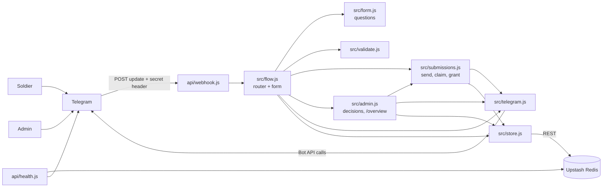
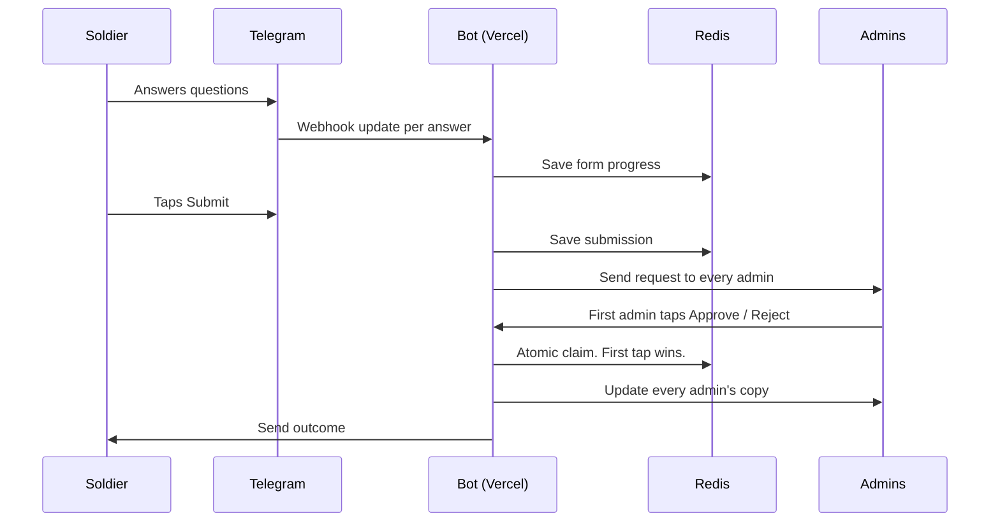

# Developer Guide

This guide covers how the Report Sick Bot works, and how to run, test, change and deploy it. For how soldiers use the bot, see the [User Guide](../README.md).

## Contents

1. [What this is](#1-what-this-is)
2. [Quick start](#2-quick-start)
3. [Architecture](#3-architecture)
4. [Code map](#4-code-map)
5. [How a request flows](#5-how-a-request-flows)
6. [Data in Redis](#6-data-in-redis)
7. [Testing](#7-testing)
8. [Deploying](#8-deploying)
9. [Admins](#9-admins)
10. [Common changes](#10-common-changes)
11. [Rules to keep](#11-rules-to-keep)
12. [Troubleshooting](#12-troubleshooting)
13. [Known issues](#13-known-issues)

---

## 1. What this is

A Telegram bot. Soldiers message it to request permission to report sick or attend a medical appointment, or to send an MC. Every admin gets the request, and the first admin to act decides the outcome.

| Part | Technology |
|---|---|
| Code | Plain JavaScript (ES modules). No build step, no runtime dependencies. |
| Hosting | Vercel serverless functions, under `api/` |
| Storage | Upstash Redis, over its REST API |
| Messaging | Telegram Bot API, through a webhook |
| Tests and CI | Bun (`bun test`) on GitHub Actions |

## 2. Quick start

**Prerequisites:** [Bun](https://bun.sh) and Git. To deploy, you also need the [Vercel CLI](https://vercel.com/docs/cli).

```sh
git clone https://github.com/choonyongchan/ReportSickBot.git
cd ReportSickBot
bun test
```

There is nothing to install. The tests use an in-memory fake of Telegram and Redis, so you don't need any secrets to run them.

To deploy, you need the five env vars listed in [`.env.example`](../.env.example). See [Deploying](#8-deploying).

> Use `bun`, not `npm` or `npx`.

## 3. Architecture

### Components



The functions are stateless. All state lives in Redis, so any function instance can handle any update.

### One request, end to end



## 4. Code map

| File | What it does |
|---|---|
| `api/webhook.js` | Entry point. Checks the secret header, calls `handle`, always returns 200. |
| `api/health.js` | `GET /api/health`. Checks Redis, the webhook and the admin list. |
| `src/flow.js` | `handle(update)` routes each update. **Start here when tracing a bug.** |
| `src/form.js` | Question text (`QUESTIONS`), step order (`FLOWS`), button steps, summary text. |
| `src/validate.js` | `invalid(step, text, state)` returns an error message, or null if the answer is OK. |
| `src/submissions.js` | Sends requests to admins, claims decisions, and manages grants. |
| `src/admin.js` | Admin button taps, the reject-reason prompt and `/overview`. |
| `src/dates.js` | `today()` in `TZ`. Parses `DDMMYY [HHMM]`. |
| `src/telegram.js` | Thin Bot API wrappers. Reads the `ADMINS` env var. |
| `src/store.js` | Thin Upstash REST wrappers. |
| `src/consts.js` | Shared helpers and constants: `WEEK`, the timezone `TZ`, and the unit's FormSG link `FORMSG`. |

## 5. How a request flows

1. **Form.** The soldier answers the steps for their request type, listed in `FLOWS` in `src/form.js`. Progress is saved in `form:<chat>`.
   - `sick`: condition, onset, body, clinic, time, ack, review
   - `appt`: purpose, when, venue, shot, pledge, review
   - `mc`: formsg, link, reason, start, end, file, review
2. **Submit.** A `sub:<id>` record is saved first. Then a `[For Admin]` message goes to every admin.
3. **Decide.** An admin taps a button, and the first tap wins (an atomic Lua script in Redis).
   - `sick` / `appt`: **Approve** or **Reject**, then **Added to BatSys?**
   - `mc`: **Acknowledge**, then **Added to BatSys?**
4. **Notify.** Every admin's copy and the soldier's summary are edited, and the soldier gets the outcome.
5. **Grant.** An approval creates a grant, which lets the soldier send one linked MC.
   - A sick grant lasts 7 days.
   - An appointment grant lasts until 7 days after the appointment.

## 6. Data in Redis

| Key | Holds | Expires |
|---|---|---|
| `form:<chat>` | The form in progress | 1 hour |
| `profile:<chat>` | The saved rank and name | Never |
| `sub:<id>` | A submission and its outcome | 7 days |
| `day:<DD/MM/YYYY>` | That day's submissions, for `/overview` | 8 days |
| `grant:<chat>` | Approved requests waiting for an MC | 1 year (each grant also has its own `until`) |
| `submit:<chat>` | Lock against double-tapping Submit | 30 s |
| `rej:<chat>` | An admin's pending reject-reason prompt | 10 min |

## 7. Testing

```sh
bun test
```

| File | Covers |
|---|---|
| `tests/unit.test.js` | Date parsing and answer validation |
| `tests/integration.test.js` | Full flows run through the webhook handler. Add new behaviour tests here. |
| `tests/fake.js` | The in-memory fake of Telegram and Redis, plus test helpers. Fixture dates come from `day(n)`, `n` days from `today()`, so they never expire. |

Some stack traces in the output are expected, because some tests cause errors on purpose.

CI (`.github/workflows/test.yml`) runs `bun test` on every push and pull request. Don't merge when CI fails.

## 8. Deploying

1. Link the project: run `vercel` in the repo folder.
2. In the Vercel dashboard, go to **Storage**, add **Upstash for Redis** and connect it. This sets `KV_REST_API_URL` and `KV_REST_API_TOKEN`.
3. Set these env vars in Vercel:

   | Var | Value |
   |---|---|
   | `BOT_TOKEN` | Get it from @BotFather |
   | `WEBHOOK_SECRET` | A random string. Only letters, digits, `_` and `-`. |
   | `ADMINS` | JSON `{"Name": telegramId}`. See [Admins](#9-admins). |

4. Deploy:

   ```sh
   vercel --prod
   ```

5. Point Telegram at the webhook:

   ```sh
   curl "https://api.telegram.org/bot<BOT_TOKEN>/setWebhook?url=https://<app>.vercel.app/api/webhook&secret_token=<WEBHOOK_SECRET>"
   ```

6. Optional, run once: set up the command menu.

   ```sh
   curl "https://api.telegram.org/bot<BOT_TOKEN>/setMyCommands" -H "content-type: application/json" \
     -d '{"commands":[{"command":"start","description":"New request or MC"},{"command":"cancel","description":"Cancel the current form"},{"command":"overview","description":"Admins: today'"'"'s overview"}]}'
   ```

7. Check that everything works: `GET https://<app>.vercel.app/api/health` should return `{"ok":true,...}`.

> Env var changes only apply after you redeploy.

## 9. Admins

### Add or remove an admin

Telegram IDs are personal data, so keep them out of git. Put them in an untracked `config.json` (it is already in `.gitignore`), shaped like `{ "admins": { "Name": 123456789 } }`. Then push it to Vercel:

```sh
vercel env rm ADMINS production   # only if it already exists
bun -e "console.log(JSON.stringify(require('./config.json').admins))" | vercel env add ADMINS production
vercel --prod
```

- To get a user's ID, have them message @userinfobot.
- Each admin must press **Start** on the bot once. Telegram doesn't let bots message users who never started them.

### What admins can do

| Action | Effect |
|---|---|
| **✅ Approve** | Approves the request and creates a grant. The soldier gets a **Send MC / Status** button. |
| **❌ Reject** | Asks for an optional reason (type it, or tap **Skip**) within 10 minutes |
| **👍 Acknowledge** | Marks an MC as received |
| **Added to BatSys?** | Records that it was entered in BatSys. Only admins see this. |
| `/overview` | Today's counts, who is waiting, and who still owes an MC. Shows names only. It is in everyone's command menu, but a non-admin only gets "Only admins can use /overview." |

An admin can't act on their own request. Another admin must do it.

## 10. Common changes

| Change | Where |
|---|---|
| Reword a question | `QUESTIONS` in `src/form.js` |
| Add or reorder a step | Add it to `QUESTIONS` and `FLOWS`. Add it to `BUTTON_STEPS` if it is answered with a button, to `invalid()` if it needs checks, and to `details()` if admins should see it. Update the tests. |
| Add a rank | `RANKS` in `src/form.js` (the keyboard shows 3 per row) |
| Change the timezone or FormSG link | `TZ` and `FORMSG` in `src/consts.js` |
| Change the Node version | `engines.node` in `package.json` (Vercel takes a major only, e.g. `26.x`) |
| Change an expiry | `WEEK` in `src/consts.js`, the grant TTL in `grant()`, and the form's `3600` in `src/flow.js` |

## 11. Rules to keep

- **The webhook always returns 200.** Any other status makes Telegram retry the update forever, so catch and log errors instead.
- **Don't add new infrastructure.** Redis hashes and `SET NX` locks are enough. Don't add a database or a queue.
- **Submit is at-least-once.** The submission is saved before admins see it, and the form is deleted last. Keep any new submit step safe to repeat.
- **Admin taps: claim first, then answer.** Put new follow-up work in the same `settle([...])` batch.
- **Send admin messages with `toAdmin`**, which adds the `[For Admin]` prefix.
- **No personal data in git.** Never commit tokens, `.env*`, `config.json`, real names or Telegram IDs.
- **Telegram limits.** Messages are capped at 4096 characters, so answers are capped at 500. Bots can't edit messages older than 48 hours.
- **`ponytail:` comments mark deliberate shortcuts.** Read them before you "fix" the code.
- **Commits:** imperative subject, 50 characters at most. Use the template: `git config commit.template .gitmessage`.

## 12. Troubleshooting

| Symptom | Check |
|---|---|
| Something is wrong | `GET /api/health`. A 503 names the failing part, and the Vercel logs give the reason. |
| Bot is silent | `https://api.telegram.org/bot<BOT_TOKEN>/getWebhookInfo` and look at `last_error_message`. A 401 means `WEBHOOK_SECRET` doesn't match. |
| An admin gets nothing | Look for `admin <name> <id>: ...` in the Vercel logs. Usually the admin never pressed Start, or the ID is wrong. |
| `redis: ...` errors | Check `KV_REST_API_URL` and `KV_REST_API_TOKEN` in Vercel |
| Works in tests but not live | Redeploy. Env vars only apply to new deployments. |
| A soldier is stuck in a form | Have them send `/start` or `/cancel`. Forms expire after 1 hour anyway. |

## 13. Known issues

None open.
